<div align="center">



<a href="https://github.com/yogeshkrishna?tab=repositories"></a>
&nbsp;
<a href="mailto:yogeshkrishna.cs25@rvce.edu.in"></a>

<br /><br />

**Python automation · Backend development · Web experiences · Curious about ML & security**

I turn everyday friction into software — from a terminal that handles forms<br />
to an event-registration backend, a strategy workbench, and a browser game.

[About](#a-little-about-me) · [Projects](#things-ive-built) · [Toolbox](#my-toolbox) · [Activity](#from-my-github) · [Connect](#lets-build-something)

</div>

## A little about me

Hey, I'm **Yogesh Krishna**, a Computer Science Engineering undergraduate at **RV College of Engineering, Bengaluru**. I like building tools I would actually use, understanding how systems fit together, and taking an idea far enough that someone else can try it.

My projects range from **Python command-line tools and browser automation** to **backend APIs, web interfaces, and games**. I'm also exploring **machine learning, computer vision, and cybersecurity** as I build up my fundamentals.

- **Building:** gformbot, a terminal workflow for preparing, reviewing, and filling Google Forms responses.
- **On campus:** part of the RVCE WebDev Team, with involvement in the RVCE IEEE Team and Helios Racing's Autonomous BAJA division.
- **Learning:** data structures, operating systems, networks, databases, and the practical side of ML.
- **Looking for:** hands-on internships, useful open-source projects, and people to build with.
- **Small detail:** some of my earliest C programs are still here. I like keeping the starting point visible.

```python
class Yogesh:
    location = "Bengaluru, India"
    studying = "Computer Science & Engineering @ RVCE"
    interests = ["automation", "backend systems", "ML", "cybersecurity"]

    def build(self, idea):
        return idea.make_it_work().test().improve()
```

## Things I've built

<table>
<tr>
<td width="50%" valign="top">

<a href="https://github.com/yogeshkrishna/google_form_test_bot"></a>

### [gformbot](https://github.com/yogeshkrishna/google_form_test_bot)

A Python CLI that turns form preparation into a guided workflow. Import CSV profiles, inspect questions, prepare answers, and choose how to review or fill them.

- Interactive wizard and scriptable commands
- Saved batches, editable previews, and CSV export
- Resumable generation and submission tracking
- Browser review and headless test filling

**Python · Selenium · CSV · CLI**

[Browse the code →](https://github.com/yogeshkrishna/google_form_test_bot) &nbsp; [On PyPI ↗](https://pypi.org/project/gformbot/)

</td>
<td width="50%" valign="top">

<a href="https://github.com/yogeshkrishna/techfestbackend"></a>

### [Techfest Registration Backend](https://github.com/yogeshkrishna/techfestbackend)

An event-registration API built as my RVCE WebDev Team selection project, covering the workflows behind a college tech fest.

- Authentication and role-based access
- Event lifecycle and seat management
- Razorpay payment and refund integration
- Queued processing, QR check-in, and exports

**Node.js · Express · PostgreSQL · Prisma · Redis · BullMQ**

[Browse the code →](https://github.com/yogeshkrishna/techfestbackend)

</td>
</tr>
<tr>
<td width="50%" valign="top">

<a href="https://github.com/yogeshkrishna/Marketsphere"></a>

### [Railguard / MarketSphere](https://github.com/yogeshkrishna/Marketsphere)

A local decision-support workbench for exploring build-versus-partner infrastructure strategies through a working sandbox.

- Compare build, partner, and hybrid scenarios
- Simulate funding routes and rail incidents
- Track balanced ledger postings
- Export and verify a hash-linked audit trail

**JavaScript · Node.js · SQLite · HTML/CSS**

*A simulation with fictional providers; it does not move real money.*

[Browse the code →](https://github.com/yogeshkrishna/Marketsphere)

</td>
<td width="50%" valign="top">

<a href="https://github.com/yogeshkrishna/cyberhack-promptathon-2026"></a>

### [CYBER HACK](https://github.com/yogeshkrishna/cyberhack-promptathon-2026)

A browser-based cyberpunk platformer, built with **Vignesh S**. Our winning submission to IEEE's Prompt-a-thon 2026.

- Grappling and wall-jump movement
- Hacking terminals and changing environments
- Patrol bots, turrets, and collectibles
- Runs directly in the browser

**JavaScript · HTML5 Canvas · CSS**

*The submitted version retains a documented boss-phase bug.*

[Browse the code →](https://github.com/yogeshkrishna/cyberhack-promptathon-2026)

</td>
</tr>
</table>

### More corners of my GitHub

| Project | What it explores | Built with |
| :--- | :--- | :--- |
| [Work Order Tracker](https://github.com/yogeshkrishna/WorkOrderTracker) | A terminal tool for creating, updating, sorting, and tracking work orders, with CSV storage and automatic overdue detection. | Python |
| [Constitution Quizzer](https://github.com/yogeshkrishna/foic_quizzer) | Random, non-repeating MCQ practice with saved progress, score summaries, and a wrong-answers-only mode. | Python · CSV · JSON |
| [IEEE RVCE Frontend](https://github.com/yogeshkrishna/IEEE-RVCE-FRONTEND) | A website interface mockup for IEEE RVCE. | Next.js · React · TypeScript |
| [Core Filter Pilot](https://github.com/yogeshkrishna/Corebound_CoreFilter_Farmer) | Experimental Android automation for Corebound; live farming remains unverified. | Java · Android |
| [Verifiable Unlearning](https://github.com/yogeshkrishna/Verifiable-Unlearning-Tech-for-a-better-tomorrow-) | A hackathon exploration using the existing *Verifiable and Provably Secure Machine Unlearning* research codebase. | Python · Research exploration |
| [My C Programs](https://github.com/yogeshkrishna/my-c-programs) | Early programs and a record of where my programming journey started. | C |

## My toolbox



| Where I use it | Tools and concepts |
| :--- | :--- |
| **Automation & utilities** | Python, Selenium, CSV/JSON processing, command-line interfaces |
| **Backend development** | Node.js, Express, REST APIs, authentication, validation, job queues |
| **Data & persistence** | PostgreSQL, MySQL, SQLite, Redis, Prisma |
| **Web & interactive work** | JavaScript, TypeScript, React, Next.js, HTML/CSS, Canvas |
| **Development workflow** | Git, GitHub, tests, CI, package builds, documentation |
| **Currently exploring** | Machine learning, computer vision, cybersecurity, and stronger CS fundamentals |

## Beyond the repositories

### A few milestones

| Milestone | The story |
| :--- | :--- |
| **🏆 IEEE Prompt-a-thon 2026 — 1st place** | Built CYBER HACK with Vignesh S for IEEE's 80th anniversary celebrations. |
| **💻 RVCE WebDev Team** | Selected through my tech-fest backend project. |
| **🐍 CS50P** | Completed CS50's Introduction to Programming with Python — August 2026. |
| **🎓 B.E. Computer Science & Engineering** | RV College of Engineering, 2025–present. |

### On my learning desk

- **Machine Learning by Andrew Ng / Stanford Online** — in progress.
- **GitHub Foundations learning path** — in progress.
- **Computer vision:** exploring deforestation detection with Sentinel-2 imagery, including a move from CNNs toward vision transformers.
- **Developer tools:** improving a command-line SQL query generator and exploring natural-language input.
- **Python utilities:** continuing work on a reversible file-organisation tool from my CS50P project.

### What I care about when I build

**Make the workflow clear.** A tool should explain what it is about to do and make its state easy to inspect.

**Plan for interruptions.** Saved progress, resumable work, and useful errors matter as much as the happy path.

**Keep improving the basics.** Each project is a chance to understand one more part of the stack, write clearer code, and leave better documentation.

## From my GitHub





<div align="center">

<sub>These cards refresh daily through GitHub Actions after setup. Language shares measure code bytes, not skill level.</sub>

[Explore all my repositories ↗](https://github.com/yogeshkrishna?tab=repositories)

</div>

## Let's build something

I'm interested in **internships, student developer teams, open-source collaboration, and practical projects** where I can contribute and learn.

Have an idea for a useful tool, a backend to build, or an experiment worth trying? Let's talk.

<div align="center">

**[yogeshkrishna.cs25@rvce.edu.in](mailto:yogeshkrishna.cs25@rvce.edu.in)** · **[GitHub / yogeshkrishna](https://github.com/yogeshkrishna)**

<br />


</div>
